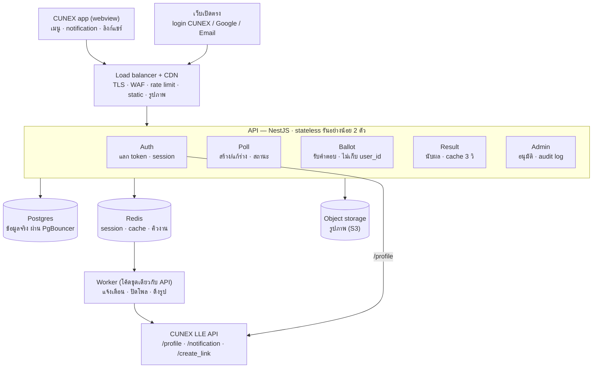
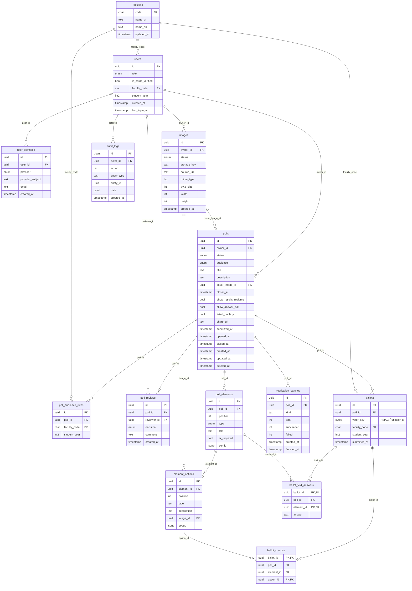

# CUNEX Poll Backend

1. [Tech stack](#1-tech-stack)
2. [High-level architecture](#2-high-level-architecture)
3. [LLE](#3-lle-requests) / [API](#4-api)
4. [DB schema](#5-db-schema)

## 1. Tech stack

สรุปสั้นๆ : **NestJS 12 + TypeScript** เขียน API, **Postgres** เก็บข้อมูลจริง, **Redis** เก็บของชั่วคราว (session, cache, queue)

| เรื่อง | ใช้อะไร | เวอร์ชัน |
| --- | --- | --- |
| Runtime | Node.js | 24 (ขั้นต่ำ 22.12) |
| ภาษา | TypeScript | 6 |
| Framework | NestJS + Express (แบบ ESM) | 12.1 |
| Validation | zod | 4 |
| Database | PostgreSQL | 16+ (เครื่อง dev ใช้ 18) |
| คุยกับ DB | Kysely + `pg` | 0.29 |
| Type ของ DB | kysely-codegen | 0.20 |
| Migration | สคริปต์เขียนเอง อ่านไฟล์ `.sql` | — |
| Cache / session / queue | Redis + ioredis | Redis 8, ioredis 6 |
| งานเบื้องหลัง | BullMQ | 6 |
| Log | pino + nestjs-pino | pino 10 |
| Health check | @nestjs/terminus | 12 |
| Test | Vitest + supertest | Vitest 4 |
| Lint / format | oxlint + Prettier | — |
| Package manager | pnpm | 11 |
| Dev บนเครื่อง | Docker Compose (Postgres + Redis) | — |

## 2. High-level architecture

สรุปสั้นๆ : ทุก request วิ่งเข้า **API ชุดเดียว** (NestJS ก้อนเดียว แบ่งเป็น 5 module) งานที่ช้าหรือต้องรอเวลาโยนให้ **Worker** ผ่านคิวใน Redis และข้อมูลจริงมีที่เดียวคือ **Postgres**

## 3. LLE Requests

| LLE endpoint | ใช้ตอนไหน | คนเรียก |
| --- | --- | --- |
| `GET /profile?token=` | ตอน login: แลก token เป็น `userId`, `facultyCode`, `studentYear` | Auth module |
| `POST /notification` | ตอนโพลเปิด แจ้งคนที่อยู่ในขอบเขตผู้ตอบ | Worker |
| `POST /create_link` | ตอนโพลเปิด สร้างลิงก์แชร์ที่เปิดแอป CUNEX | Worker |

## 4. API

### Auth

| Method | Path | ใครเรียก | ทำอะไร |
| --- | --- | --- | --- |
| GET | `/auth/cunex/login` | ทุกคน | พาไปหน้า login ของ CUNEX |
| GET | `/auth/cunex/callback?token=` | ทุกคน | แลก token กับ `/profile` สร้าง session แล้ว redirect ไป URL ที่ไม่มี token |
| GET | `/auth/google/login`, `/auth/google/callback` | ทุกคน | login ด้วย Google |
| POST | `/auth/email/otp` | ทุกคน | ส่งรหัส 6 หลักทางอีเมล |
| POST | `/auth/email/verify` | ทุกคน | ตรวจรหัสแล้วสร้าง session |
| POST | `/auth/logout` | คนที่ login | ออกจากระบบ |
| POST | `/auth/dev/login` | เฉพาะ dev/staging | ป็อปอัป "เลือกบัญชีทดลอง" |
| GET | `/me` | คนที่ login | ข้อมูลตัวเอง (role, คณะ, ปีเข้า) |

### ดูโพล

| Method | Path | ใครเรียก | ทำอะไร |
| --- | --- | --- | --- |
| GET | `/faculties` | คนที่ login | รายชื่อคณะ ใช้ตอนเลือกขอบเขตผู้ตอบ |
| GET | `/polls` | คนที่ login | หน้ารวมโพล (เฉพาะโพลที่เรามีสิทธิ์ตอบ) |
| GET | `/me/polls` | คนที่ login | โพลที่ฉันสร้าง |
| GET | `/polls/:id` | คนที่ login | รายละเอียดโพล + ฉันตอบไปแล้วหรือยัง |

### สร้างและจัดการโพล (เจ้าของ)

| Method | Path | ทำอะไร |
| --- | --- | --- |
| POST | `/polls` | สร้างร่างใหม่ |
| PUT | `/polls/:id` | บันทึกร่าง**ทั้งก้อนทีเดียว** (ตั้งค่า + ขอบเขต + element ทุกตัวตามลำดับ) |
| DELETE | `/polls/:id` | ลบร่าง |
| POST | `/polls/:id/submit` | ส่งขออนุมัติ |
| PATCH | `/polls/:id/closes-at` | เลื่อนเวลาปิด (สิ่งเดียวที่แก้ได้หลังอนุมัติ) |
| POST | `/polls/:id/close` | ปิดก่อนกำหนด |

### รูปภาพ

| Method | Path | ทำอะไร |
| --- | --- | --- |
| POST | `/images/uploads` | ขอ presigned URL แล้ว client อัปโหลดตรงไป storage |
| POST | `/images/:id/complete` | บอกว่าอัปโหลดเสร็จ ให้ server ตรวจไฟล์ |
| POST | `/images/import` | ใส่ URL รูปภายนอก แล้ว worker ดึงมาเก็บเอง |
| GET | `/images/:id` | เช็กสถานะ import |

### ตอบโพล

| Method | Path | ทำอะไร |
| --- | --- | --- |
| GET | `/polls/:id/ballot` | ดึงคำตอบเดิมของฉัน (ไว้เติมตอนแก้) |
| PUT | `/polls/:id/ballot` | ส่งคำตอบครั้งแรก หรือแก้คำตอบ |

Error ที่ต้องรองรับตอนตอบโพล:

| status | code | เกิดตอน |
| --- | --- | --- |
| 404 | `POLL_NOT_FOUND` | ไม่เห็นโพลนี้ |
| 403 | `NOT_ELIGIBLE` | คณะ/ปีไม่ตรงขอบเขต |
| 409 | `POLL_CLOSED` | โพลปิดแล้วหรือเลยเวลา |
| 409 | `ALREADY_VOTED` | ตอบแล้ว และโพลไม่เปิดให้แก้ |
| 422 | `INVALID_ANSWERS` | ตอบไม่ครบ หรือเลือกตัวเลือกที่ไม่มี |

### ดูผล

| Method | Path | ใครเรียก | ทำอะไร |
| --- | --- | --- | --- |
| GET | `/polls/:id/results?breakdown=` | เจ้าของ, admin, ผู้ตอบ (ตามกติกา) | นับผล แยกตามคณะหรือปีได้ cache 3 วินาที |
| GET | `/polls/:id/results/text` | เจ้าของ, admin | คำตอบแบบข้อความ |

### Admin

| Method | Path | ทำอะไร |
| --- | --- | --- |
| GET | `/admin/polls?status=pending_review` | คิวรออนุมัติ |
| POST | `/admin/polls/:id/approve` | อนุมัติ → โพลเปิด แล้ว worker ส่ง notification + สร้างลิงก์ |
| POST | `/admin/polls/:id/reject` | ตีกลับ (ต้องใส่เหตุผล) |
| POST | `/admin/polls/:id/takedown` | บังคับปิดโพลที่มีปัญหา |
| GET / POST / DELETE | `/admin/admins` | ดู / เพิ่ม / ถอด admin |
| GET | `/admin/audit-logs` | ดูประวัติการกระทำของ admin |

## 5. DB schema

ไฟล์จริง: [db/migrations/0001_init.sql](../db/migrations/0001_init.sql)

